<p align="center">
  
</p>

<h1 align="center">Inkwell</h1>
<p align="center"><b>Offline-first handwriting &amp; note-taking app for phone, tablet and desktop.</b><br>
Installable PWA · Django backend · cloud sync · sharing · live collaboration · runs on shared hosting without Node.</p>

<p align="center">
  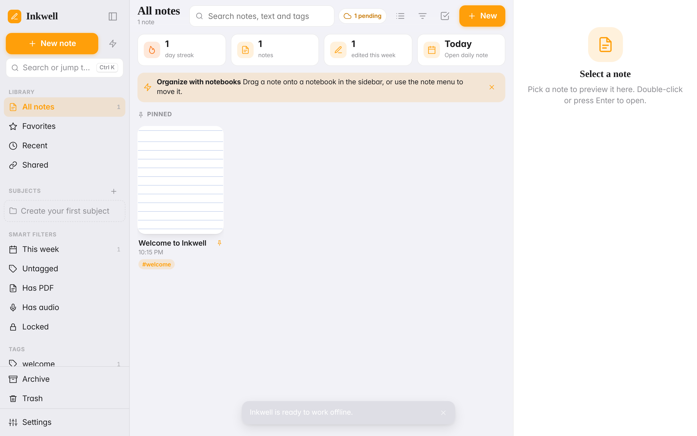
</p>

## Contents
[Overview](#overview) · [Screenshots](#screenshots) · [Features](#features) · [Architecture](#architecture) · [Quick start](#quick-start) · [Deployment modes](#deployment-modes) · [Configuration](#configuration) · [Deploying to shared hosting](#deploying-to-shared-hosting) · [Security](#security) · [Sync & offline](#sync--offline) · [Sharing & collaboration](#sharing--collaboration) · [Admin dashboard](#admin-dashboard) · [Project layout](#project-layout) · [Status & limitations](#status--limitations) · [License](#license)

## Overview
Inkwell is a note-taking app in the spirit of Notability-style apps: write with a stylus or finger, type, annotate PDFs, record audio and organise everything in subjects and tags. Notes are saved **on the device first**, so the app is fully usable offline. When you are signed in, changes sync to your own server in the background and across all your devices.

- **Frontend:** Vite + vanilla ES modules, IndexedDB, Service Worker (installable PWA).
- **Backend:** Django 4.2 + SQLite (or MySQL), plain HTTP JSON API. No Redis, Celery or WebSockets, so it fits cPanel/shared hosting.
- **No Node on the server:** the built frontend is committed in `backend/inkwell/static_app/`. Production needs only Python.

## Screenshots
| Library (dark) | Editor (dark) |
|---|---|
| 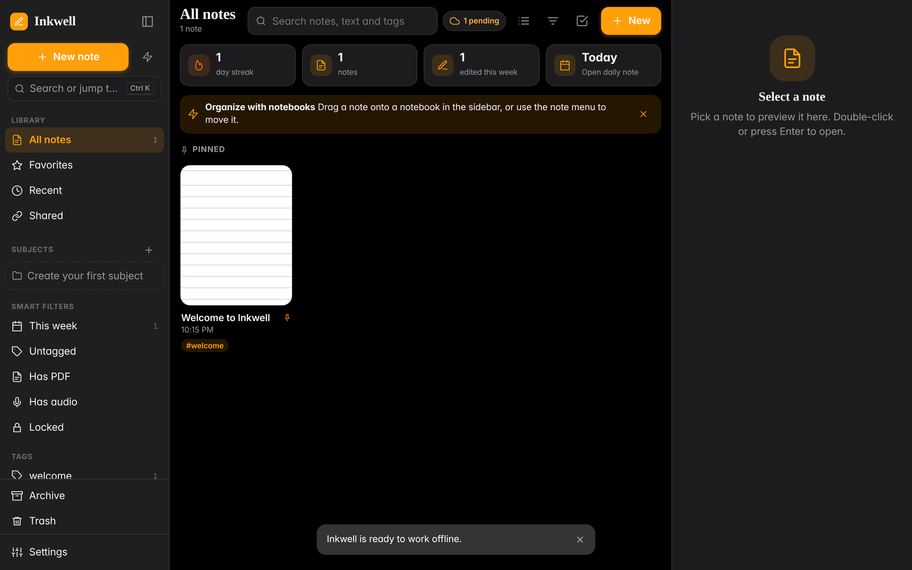 | 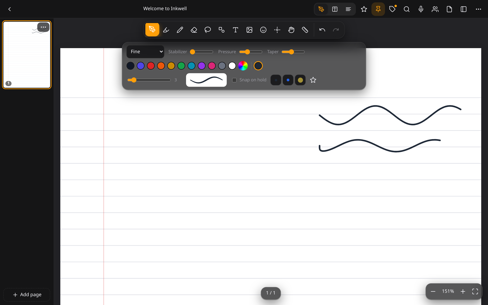 |

| Editor (light) | Settings |
|---|---|
| 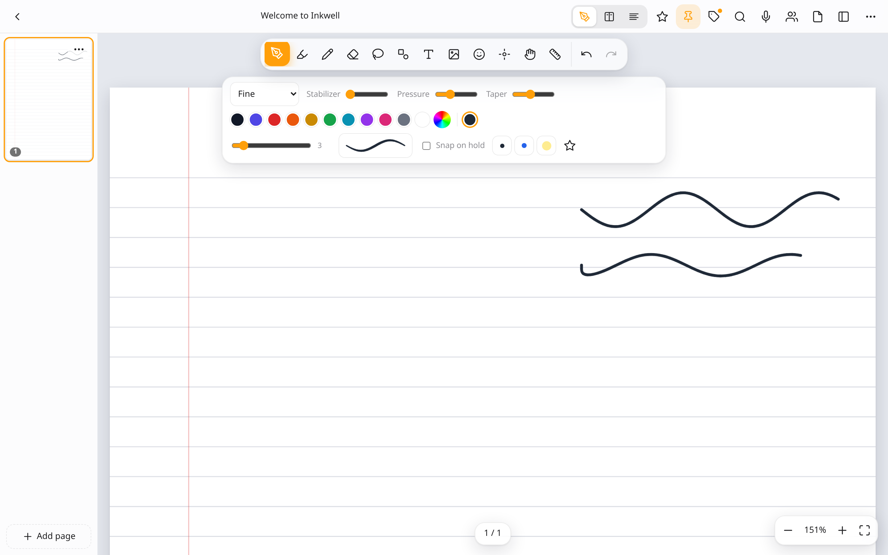 | 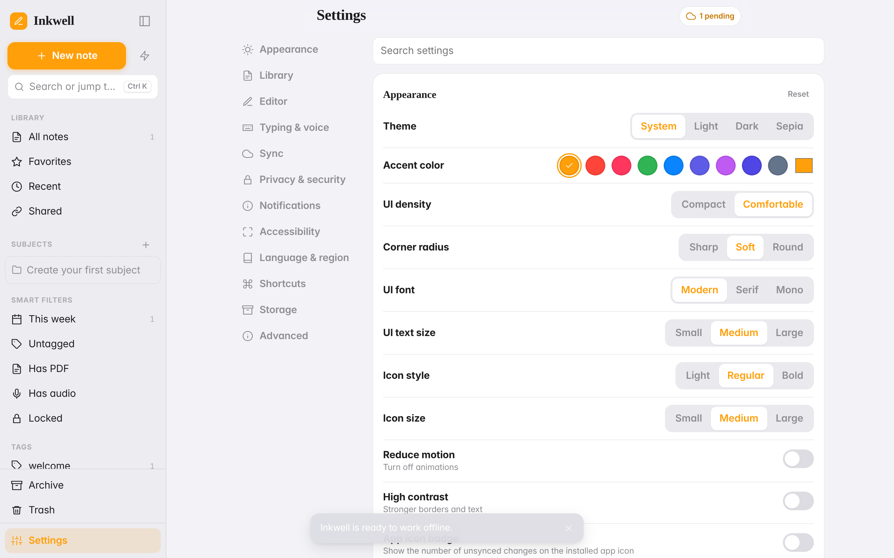 |

| Tablet | Phone | Phone (editor) |
|---|---|---|
| 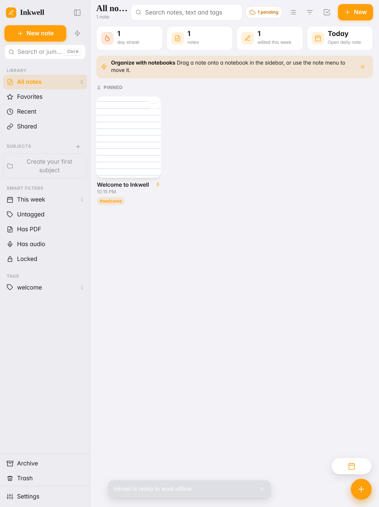 | 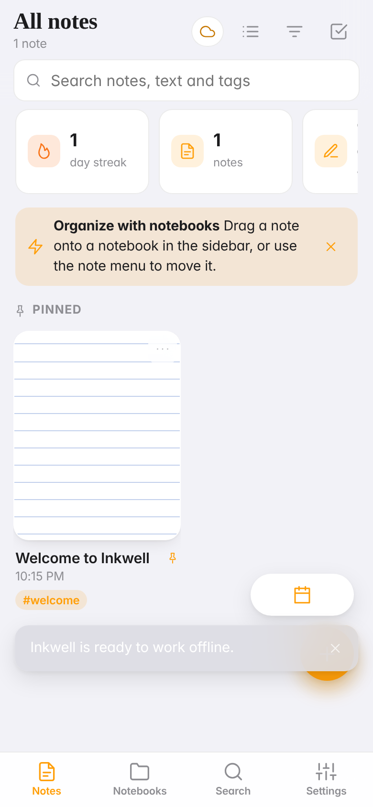 | 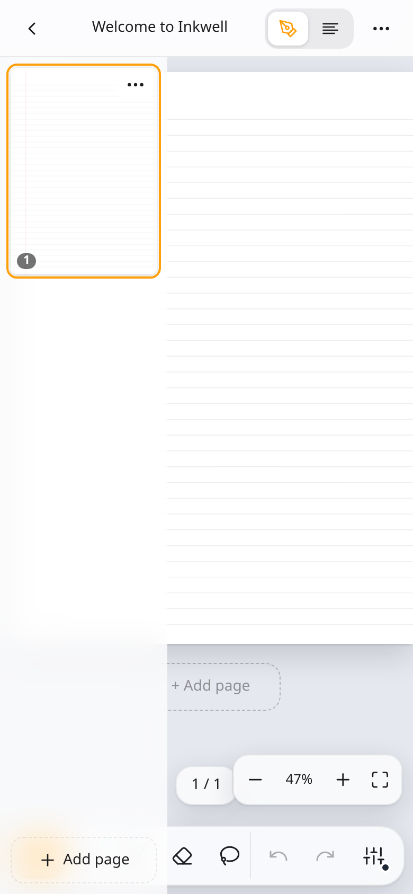 |

| Sign in | Show/hide password | Admin dashboard |
|---|---|---|
| 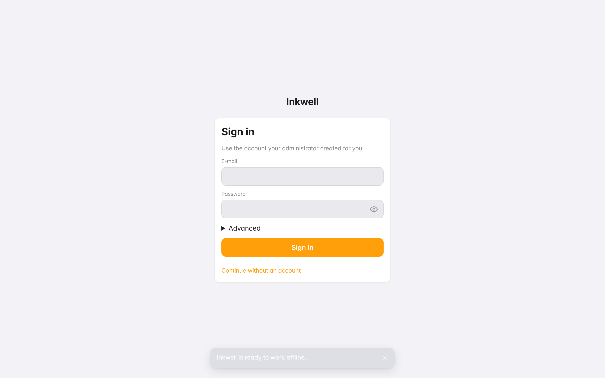 | 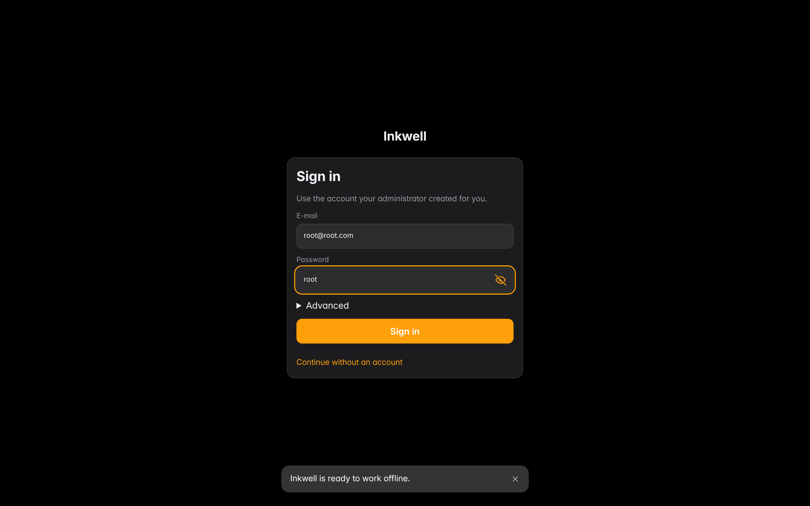 | 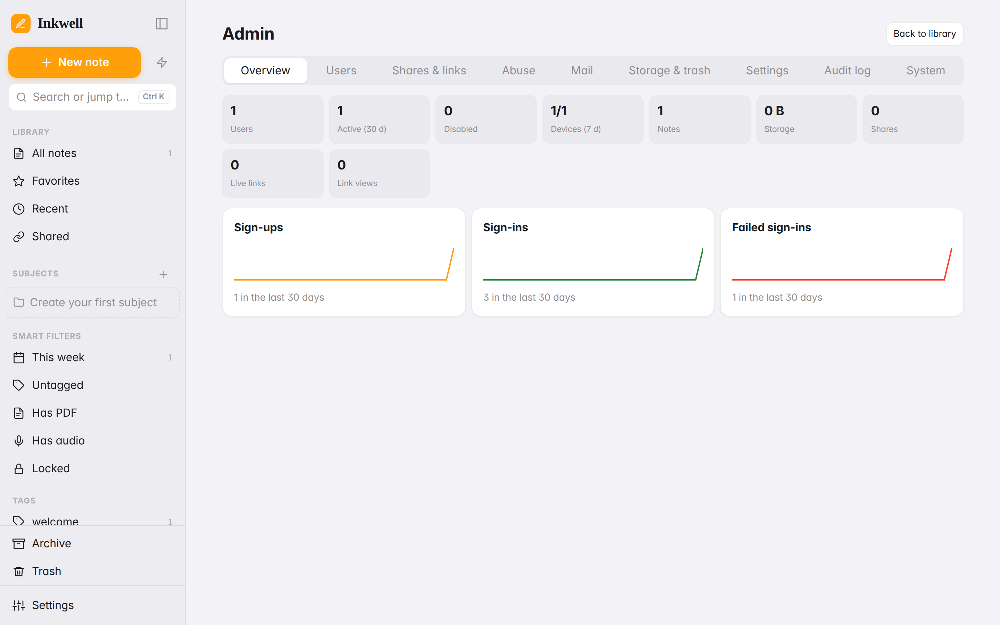 |

## Features
**Writing**
- Pressure-sensitive ink with palm rejection, smoothing, undo/redo, zoom and pan.
- Pen, highlighter, pencil and further brushes (stabilizer, pressure, taper), eraser, lasso selection, shapes, text boxes, images, stickers.
- Typed-notes view (rich text), split view, multiple pages, page templates (lined, grid, dot, Cornell, planner, to-do and more).
- Read-aloud (text-to-speech) and dictation where the browser supports them; system and imported fonts.
- PDF import and annotation, audio recording synced to handwriting.

**Organising**
- Nested subjects (notebooks), tags, favourites, pins, archive, trash with 60-day auto-delete and restore.
- Smart filters, global search, command palette (`Ctrl/Cmd+K`), `[[note links]]` with backlinks, daily note, per-note passcode lock, app lock.
- Export as **PDF** only (single note, or a ZIP of PDFs per notebook).

**App experience**
- Installable, standalone, native-feeling gestures, light/dark/sepia themes, accent colours, many customisable settings (appearance, editor, voice, sync, privacy, accessibility).
- Layouts for phone (tab bar), tablet (sidebar + grid) and desktop (three panes, keyboard shortcuts).

**Accounts & collaboration**
- E-mail login, optional TOTP two-factor, device/session list, profile (name and avatar; the e-mail cannot be changed by the user).
- Share with people (read or write) or publish a public link, each optionally password protected and expiring.
- Presence ("who is here and what are they doing") and an activity timeline per note.
- Custom admin dashboard (users, devices, shares, abuse, mail, storage, audit log).

## Architecture
```
Browser (PWA)                               Server (Django, shared-hosting friendly)
┌────────────────────────────┐   HTTPS     ┌──────────────────────────────┐
│ UI + editor (vanilla JS)   │  JSON API   │ /api/auth  /api/sync  /api/… │
│ IndexedDB  (source of truth│◄───────────►│ SQLite / MySQL + media files │
│ on the device)             │  polling    │ WhiteNoise serves the build  │
│ Service Worker (offline)   │             └──────────────────────────────┘
│ Outbox: queued changes     │
└────────────────────────────┘
```
Last-write-wins per record using `updatedAt`, tombstones for deletions, and a conflicted-copy note when two devices edit the same note at the same time. See [`ARCHITECTURE.md`](ARCHITECTURE.md), [`backend/README.md`](backend/README.md) (API) and [`docs/DEVELOPMENT.md`](docs/DEVELOPMENT.md).

## Quick start
Requirements: **Python 3.10+** (server and development) and **Node 18+** (development machine or CI only, never on the production server).

### One command
```bash
git clone https://github.com/himaldahal/inkwell.git && cd inkwell
./scripts/setup-dev.sh --email you@example.com --password 'a-strong-password' --run
```
`scripts/setup-dev.sh` creates the Python virtual environment (`backend/.venv`), installs `requirements.txt`, writes a development `backend/.env` with a freshly generated `SECRET_KEY`, runs the migrations, creates the superuser, installs the npm packages and (with `--run`) starts Django on `:8000` and Vite on `:5173`. It is safe to re-run. Options: `--no-frontend` (backend only), `--mode internal|commercial`, `--email/--password`, `--run`.

### Manual setup
```bash
cd backend
python3 -m venv .venv && . .venv/bin/activate
pip install -r requirements.txt
cp .env.example .env              # set SECRET_KEY (required); DEBUG=1 for local work
python manage.py migrate
python manage.py create_admin --email you@example.com --password 'a-strong-password' --superuser
python manage.py runserver 127.0.0.1:8000
```
Open <http://127.0.0.1:8000> to use the committed build. To work on the frontend with hot reload:
```bash
npm install
npm run dev                       # http://localhost:5173, /api is proxied to Django on :8000
```
When you are done, `npm run build` writes the production bundle to `backend/inkwell/static_app/` (committed, so servers do not need Node).

## Development configuration
| Task | Command |
|---|---|
| Backend dev server | `cd backend && . .venv/bin/activate && python manage.py runserver` |
| Frontend dev server | `npm run dev` |
| Production build | `npm run build` |
| Backend tests | `cd backend && python manage.py test` |
| Regenerate icons | `node scripts/gen-icons.mjs` |
| Release package for hosting | `scripts/build-release.sh` (creates `inkwell-deploy.zip`) |
| Purge expired trash manually | `python manage.py purge_trash` |

Development `.env` essentials: `SECRET_KEY=<long random string>`, `DEBUG=1`, `DEPLOYMENT_MODE=internal`, `ALLOWED_HOSTS=127.0.0.1,localhost`. Without `DEBUG=1`, cookies and HSTS are strict and the app expects HTTPS. Without SMTP settings, e-mails are written to the console.

## Production configuration
Set these on the server (environment variables or `backend/.env`; full list in [`backend/.env.example`](backend/.env.example)):

| Variable | Purpose |
|---|---|
| `SECRET_KEY` | **Required.** Long random string. The app refuses to start without it |
| `DEBUG` | `false` in production |
| `ALLOWED_HOSTS` | Your domain(s), comma separated |
| `APP_URL` | Public URL, used in e-mail links |
| `DEPLOYMENT_MODE` | `internal` or `commercial` |
| `DB_PATH` / `DB_ENGINE=mysql` + `DB_NAME`, `DB_USER`, `DB_PASSWORD`, `DB_HOST` | Database (SQLite by default; keep the file outside the web root) |
| `MEDIA_ROOT` | Where uploaded files live (outside the web root) |
| `EMAIL_HOST`, `EMAIL_PORT`, `EMAIL_USER`, `EMAIL_PASSWORD`, `EMAIL_USE_TLS` / `EMAIL_USE_SSL`, `DEFAULT_FROM_EMAIL` | SMTP (needed in `commercial` mode) |
| `TRUSTED_PROXIES` | Proxy addresses whose `X-Forwarded-For` is trusted (rate limits, audit IPs) |
| `TRASH_RETENTION_DAYS` | Defaults to 60 |
| `ASSET_QUOTA_MB`, `ASSET_MAX_MB` | Per-user storage and per-file limits |
| `EMBED_HOSTS` | Extra hosts allowed for embeds |

### Deployment checklist
1. On your machine run `scripts/build-release.sh` (or download the `inkwell-deploy.zip` artifact from CI). No Node is needed on the server.
2. Upload and extract it. On cPanel use **Setup Python App** (Python 3.10+), startup file `passenger_wsgi.py`, then `pip install -r requirements.txt`.
3. Set the variables above, then run `python manage.py migrate` and `python manage.py create_admin --email ... --superuser`.
4. Serve over **HTTPS** (needed for the service worker, installation and the proof-of-work check).
5. Optional: add a daily cron job `python manage.py purge_trash` (expired trash is also purged lazily without cron).
6. Updating: upload the new release, run `python manage.py migrate`, restart the Python app.

Step-by-step with cPanel specifics, SMTP examples and troubleshooting: [`DEPLOY.md`](DEPLOY.md).

## Deployment modes
Set `DEPLOYMENT_MODE` in `backend/.env`:

| | `internal` (default) | `commercial` |
|---|---|---|
| Sign-up | Disabled. Administrators create users in the admin dashboard | Public sign-up with e-mail verification |
| Password reset | Done by an administrator | Self-service by e-mail (SMTP required) |
| Public links | Require sign-in by default; administrators may allow anonymous links | Anonymous links allowed |
| SMTP | Not needed | Required |

## Configuration
Everything is configured through environment variables or `backend/.env` (see [`backend/.env.example`](backend/.env.example)): `SECRET_KEY`, `DEBUG`, `ALLOWED_HOSTS`, `APP_URL`, `DEPLOYMENT_MODE`, database (`DB_PATH` or MySQL settings), `MEDIA_ROOT`, upload quotas, trash retention, SMTP (`EMAIL_HOST`, `EMAIL_PORT`, `EMAIL_USER`, `EMAIL_PASSWORD`, `EMAIL_USE_TLS`/`EMAIL_USE_SSL`, `DEFAULT_FROM_EMAIL`), `TRUSTED_PROXIES`, optional `LONGPOLL` and TURN settings. The app refuses to start in production without a `SECRET_KEY`.

## Deploying to shared hosting
Full guide: [`DEPLOY.md`](DEPLOY.md). In short, with cPanel "Setup Python App" (Passenger):
1. Run `scripts/build-release.sh` on your machine to get `inkwell-deploy.zip` (backend plus built frontend, no Node needed on the server), and upload and extract it.
2. Create the Python app, point the startup file at `passenger_wsgi.py`, and `pip install -r requirements.txt`.
3. Set the environment variables (at minimum `SECRET_KEY`, `ALLOWED_HOSTS`, `APP_URL`, `DEBUG=false`), then run `python manage.py migrate` and `python manage.py create_admin`.
4. Serve over HTTPS (required for service workers, installability and the proof-of-work check).

## Security
- E-mail-only login; Django password hashing and validators; optional TOTP 2FA with recovery codes; hashed, expiring, rotating API tokens; device list with revoke.
- No ID enumeration: every query is scoped to the signed-in user, unauthorised and missing resources look identical, record ids are namespaced per owner, share tokens are random and stored hashed, responses to sign-in/reset/invites do not reveal whether an account exists.
- User-to-user safety: strict validation of every synced record, server-side sanitisation of shared HTML, strict CSP, sandboxed public pages, upload type checks by file signature, size limits.
- Abuse protection: database-backed rate limits (per IP, account and address), lockouts, honeypot, timing and proof-of-work checks on public forms, disposable-domain blocklist, suppress list, queued e-mail with per-address caps (so nobody can be mail-bombed), resend cool-downs that grow, daily invite caps.
- Privacy: other users' IP addresses are never exposed. Live editing goes through the server by default; optional peer-to-peer uses relay-only ICE (TURN) so peers do not see each other's addresses. Optional end-to-end encryption of synced note content with a passphrase.
- Please report vulnerabilities privately to the repository owner.

## Sync & offline
- Writes always go to IndexedDB first; a persistent outbox survives reloads and crashes.
- Sync runs on start, on a timer (faster while a shared note is open), shortly after edits, when the device comes back online, when the tab becomes visible, and via Background Sync where the browser supports it.
- Retries use exponential backoff with jitter; large files upload in resumable chunks.
- Real-time collaboration uses adaptive HTTP polling, because shared hosts do not offer WebSockets.

## Sharing & collaboration
Share a note or notebook with people by e-mail (viewer or editor), or publish a link at `/s/<token>` with optional password, expiry, download toggle and revoke. Collaborators see who is present and an activity timeline ("Alex drew 14 strokes on page 2").

## Admin dashboard
Staff open `#/admin` in the app: overview charts, user management (create, disable, reset password, quotas, revoke sessions), devices with parsed browser/OS and IP, shares and public links, abuse centre, mail queue and suppress list, storage and trash tools, runtime settings, audit log and system health.

## Project layout
```
src/            frontend (core data layer, ui, editor, features: pdf/audio/export)
public/         manifest assets, icons, service-worker helpers
backend/        Django project (api/, inkwell/, static_app/ = committed build)
scripts/        icon generation, release packaging
docs/           developer notes and screenshots
DEPLOY.md       cPanel / shared hosting guide
ARCHITECTURE.md data model and module contracts
```

## Status & limitations
Inkwell is under active development. Be aware of the following:
- Some features have been exercised only lightly (for example PDF export output, audio recording, voice features, touch gestures, font import, and the offline-PDF flow); expect rough edges.
- Planned but not built yet: layers, infinite canvas, protractor/compass tools, function plotter, table cell editing, bookmarks/outline, image crop, handwriting search (OCR).
- The per-note passcode lock is a UI gate; use end-to-end encryption for content that must be unreadable on the server.
- Peer-to-peer live sessions need a TURN server and are optional; the HTTP relay works everywhere.
- Browser support for read-aloud, dictation and system-font access varies (Chrome/Edge work best).

## License
[MIT](LICENSE)
